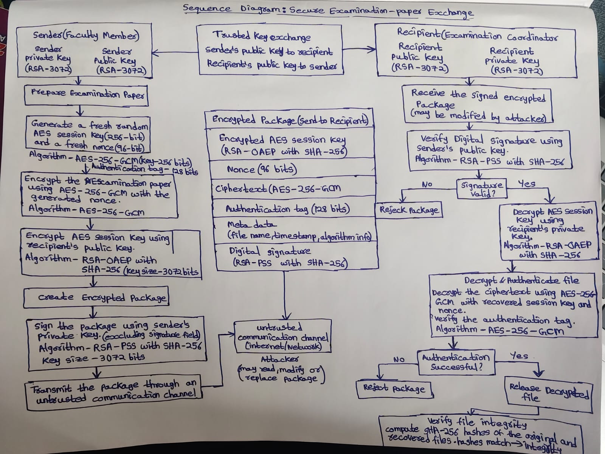

# Secure Examination-Paper Exchange Using Python

A Python application for securely transmitting confidential examination papers from a faculty member (sender) to an authorized examination coordinator (recipient) over an untrusted communication channel.

The application uses hybrid encryption, RSA digital signatures, and authenticated encryption to protect the examination paper and detect unauthorized modifications.

## Objectives

- Protect examination-paper confidentiality.
- Verify the sender's digital signature.
- Detect unauthorized modifications to the encrypted package.
- Reject invalid packages without releasing unverified plaintext.
- Demonstrate secure communication using separate sender and recipient folders on one computer.

## Cryptographic Algorithms

| Purpose | Algorithm and Parameters |
|---|---|
| RSA key generation | RSA-3072 |
| File encryption | AES-256-GCM |
| AES session key | Random 256-bit key |
| GCM nonce | 96 bits (12 bytes) |
| GCM authentication tag | 128 bits (16 bytes) |
| Session-key protection | RSA-OAEP with SHA-256 |
| Digital signature | RSA-PSS with SHA-256 |
| File-integrity comparison | SHA-256 |

The application uses the Python `cryptography` library for established cryptographic operations.

## How the Application Provides Security

### 1. Confidentiality

A fresh random AES-256 session key encrypts the examination paper using AES-GCM. The AES session key is then encrypted using the recipient's RSA-3072 public key with OAEP and SHA-256.

Only the recipient possessing the corresponding private key can recover the session key and decrypt the examination paper.

### 2. Integrity

AES-GCM generates an authentication tag that detects changes to the ciphertext and authenticated metadata. The sender's RSA-PSS digital signature also protects the complete package payload, including the encrypted session key, nonce, ciphertext, authentication tag, and metadata.

The recipient verifies the signature before recovering the session key and checks GCM authentication before writing the decrypted file. Invalid packages are rejected.

SHA-256 hashes of the original and recovered files were also compared during testing and matched.

### 3. Sender Authentication

The sender signs the package using their RSA-3072 private key with RSA-PSS and SHA-256. The recipient verifies the signature using a trusted copy of the sender's public key.

Successful verification demonstrates that the package was signed using the private key corresponding to the trusted public key and that the signed content has not been modified. Authenticity depends on securely exchanging and trusting the sender's public key.

## Communication Workflow

1. Generate separate RSA-3072 key pairs for the sender and recipient.
2. Exchange public keys through a trusted channel.
3. Prepare the examination paper.
4. Generate a fresh random AES session key and nonce.
5. Encrypt the file using AES-256-GCM.
6. Encrypt the AES session key using the recipient's RSA public key with OAEP and SHA-256.
7. Assemble the encrypted package and sign its payload using RSA-PSS and SHA-256.
8. Transfer the signed encrypted package through the untrusted channel.
9. Verify the signature using the trusted sender public key.
10. Recover the AES session key using the recipient's private key.
11. Decrypt and authenticate the file using AES-GCM.
12. Release the recovered file only after successful authentication.


## Project Structure

```text
SecureExamExchange/
|-- secure_exchange.py
|-- sender/
|   |-- input/
|   |-- outgoing/
|   `-- trusted_public/
|-- recipient/
|   |-- incoming/
|   |-- recovered/
|   `-- trusted_public/
|-- tests/
|-- screenshots/
|-- .gitignore
`-- README.md
```

Private keys are generated locally and excluded from version control.

## Requirements

- Python 3.13 or a compatible Python version
- `cryptography` Python package

Install the dependency:

```powershell
python -m pip install cryptography
```


## Running the Application

Run these commands from the project root directory. The commands assume that the required keys and input file have already been created.

### Encrypt and sign the examination paper

```powershell
python secure_exchange.py encrypt --input sender/input/examination.txt --output sender/outgoing/examination_paper.secure.json --sender-private sender/private/sender_private.pem --recipient-public sender/trusted_public/recipient_public.pem
```

Enter the sender's private-key password when prompted.

### Transfer the encrypted package

```powershell
Copy-Item sender/outgoing/examination_paper.secure.json recipient/incoming/examination_paper.secure.json -Force
```

### Verify and decrypt as the recipient

```powershell
python secure_exchange.py decrypt --package recipient/incoming/examination_paper.secure.json --output-dir recipient/recovered --sender-public recipient/trusted_public/sender_public.pem --recipient-private recipient/private/recipient_private.pem
```

Enter the recipient's private-key password when prompted.

### Run security tests

```powershell
python secure_exchange.py selftest
```

## Testing Results

All eight automated self-tests passed in the recorded run.

| Test | Result |
|---|---|
| Authorized recipient recovery | PASS |
| Modified ciphertext | Rejected |
| Modified metadata | Rejected |
| Modified digital signature | Rejected |
| Incorrect recipient private key | Rejected |
| Incorrect sender public key | Rejected |
| Repeated encryption produces different packages | PASS |
| Corrupted ciphertext rejected after valid signature verification | PASS |

The SHA-256 hashes of the original and recovered examination papers matched.

Detailed results are available in `tests/test_results.txt`.

## Sequence Diagram

The sequence diagram illustrates the trusted public-key exchange, sender-side encryption and signing, transmission through an untrusted channel, recipient-side signature verification, session-key recovery, authenticated decryption, and rejection paths.



## Security Notes

- Never share or commit private keys or private-key passwords.
- Exchange public keys through a trusted channel and verify their authenticity.
- Use a fresh AES session key and nonce for every encryption.
- Do not release decrypted files if signature verification or AES-GCM authentication fails.
- This project demonstrates secure file exchange in a local simulation; production deployments also require secure key management, access controls, and appropriate operational safeguards.

## Conclusion

This project demonstrates hybrid cryptography for secure examination-paper exchange. AES-256-GCM protects confidentiality and provides authenticated encryption, RSA-OAEP protects the AES session key, and RSA-PSS digital signatures provide package integrity and sender-key authentication.

The authorized recipient successfully recovered the original file, all eight automated self-tests passed, and the original and recovered file hashes matched.

**Technology:** Python · `cryptography` · RSA · AES-GCM · SHA-256
